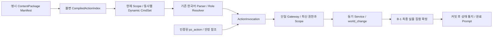

# Action 아키텍처 Phase 1

규범은 [#44 v4.3 Design Freeze](https://github.com/wonmin82/primal-zone/issues/44), 구현 범위는 [#65](https://github.com/wonmin82/primal-zone/issues/65)다. D01~D17, B-1, ItemEntity D안, R1/R2/R3 정책을 변경하지 않는다. 기존 실제 게임 동사의 전환은 #66, 전 기능 교차 검증은 #67의 책임이다.

## 구성과 기술 선택



| 선택 | 구현과 이유 |
| --- | --- |
| T01 패키지/Manifest | `world/actions/`에 공통 계층을 둔다. 설정 `ACTION_CONTENT_PACKAGES`의 모듈마다 `PACKAGE` 하나를 명시적으로 읽는다. 자동 discovery·런타임 임의 등록은 없다. |
| T02 타입 | frozen dataclass와 StrEnum, tuple, MappingProxyType으로 정의와 컴파일 인덱스를 불변으로 유지한다. |
| T03 캐시 | 설정 경로별 컴파일 인덱스만 LRU 캐시한다. Scope는 매 명령 새로 조회하고 CmdSet에는 동사/Variant만 저장한다. 대상/권한 스냅샷을 캐시하지 않는다. |
| T04 Hook | 실제 Evennia 6.1.0의 `Explorer.at_cmdset_get`에서 병합 전에 갱신한다. 기존 parser→PromptLifecycle→pre/parse/func/post 경로를 사용한다. |
| T05 Help | `presentation.help_entries`가 공개 선언의 안내·예시·Variant를 제공한다. `동사 도움`과 웹 controls가 같은 메타데이터를 읽는다. |
| T06 결과 | `ActionResult`의 SUCCESS/REFUSED/ERROR/CONFIRMATION. 비성공은 ResultAbort로 DB·캐시 변경을 롤백하고 어댑터가 출력한다. |
| T07 진단 | 안전한 공개 동사 진단과 고정 오류 분류를 사용한다. 자유 예외·입력·인증정보·대상 원문 로그를 추가하지 않는다. |
| T08 Service | `ServiceDefinition.handler(ExecutionContext)` 하나로 도메인 API를 호출한다. 기존 도메인별 권한·비용·효과를 재사용하고 콘텐츠별 중앙 분기를 추가하지 않는다. |

실행 버전은 로컬 Python 3.13 / 잠금 파일의 Evennia 6.1.0 / SQLite다. Evennia의 일반 `func()`는 Deferred를 기다리지 않는다. 등록과 Gateway는 직접·보조 함수의 coroutine/generator/Deferred/예약 입력 경로를 검사하며 실제 반환값도 ActionResult로 제한한다. Python Manifest는 신뢰된 소스다. 동적 Python 호출의 모든 임의 부작용을 OS 수준에서 격리한다는 뜻은 아니며, 새 Service의 도메인 검사도 필요하다.

## 선언과 실행 계약

`validation_content.PACKAGE`는 신규 `검측`/`계측` 동사, 복수 검증기, 횟수 Service, Root Item 자기 Provider, 시체 Source ALL, 전리품 권리 검증을 선언한다. `normal`과 `confirmed`는 별도 SyntaxVariant다. 이 콘텐츠는 테스트 override와 격리 E2E 설정에서만 활성화한다. Phase 1 당시 빈 tuple이던 운영 Manifest는 Issue #66에서 명시적으로 전환하며, 현재 구성과 검증 진행은 아래 운영 콘텐츠 절과 [Action 전환표](action-migration.md)를 따른다.

```python
RoleDefinition("subject", (ReferenceKind.ITEM,),
               DefaultTargetPolicy.FIRST_LEGACY_ORDER, allow_all=True)
SyntaxVariant("all", r"모든 (?P<source>.+)에서", all_roles=("source",))
ActionBinding("example.binding", "example.provider", "example.action", "example.service")
```

Role의 생략 기본 선택과 복수 선택 허용은 별개다. 독립 Provider 생략은 후보가 유일할 때만 허용한다. `provider_from`은 Subject/Source를 먼저 선택한 뒤 같은 안정 참조를 Provider로 파생한다. 여러 Source가 같은 Binding을 공유하면 한 Service를 한 번 호출한다. 명시 대상의 실패는 다른 대상 실행으로 바뀌지 않는다.

`SyntaxVariant.all_when`은 `(역할 이름, 인자 이름, 선언 값)` tuple로 인자에 따른 전체 선택을 선언한다. 예를 들어 Storage의 `all_when=(("subject", "count", "모두"),)`는 텍스트의 `붕대 모두`를 현재 접근 가능한 같은 품목의 전체 Subject로 선택한다. Registry는 존재하는 Role/Argument, 전체 선택 허용과 선언 값 타입을 검사하고 Resolver가 조건에 맞는 참조 집합을 만든다. Gateway는 이미 확정된 안정 참조 목록의 Role·Scope·권한을 재검증한다. 웹도 받은 목록만 사용한다. 스택 전부 버튼의 `count="모두"`는 payload가 지정한 UUID 하나의 전량이며 다른 스택을 자동 추가하지 않는다. `variant.id`나 콘텐츠 이름을 중앙 Parser의 예외 조건으로 사용하지 않는다.

선택 순서는 정확한 실제 이름 → 명시 번호/별칭 문법 → 선언된 기본 정책이다. 숫자로 끝나는 실제 이름을 먼저 확인한다. B-1 숫자는 후보 배열 인덱스가 아니다. 별칭은 독립 번호를 만들지 않는다. `이름 1` 호환은 명시 등록된 고유 선택 이름이 실제로 유일할 때만 허용한다. `시`/`시2`~`시5` 고정 단축어는 기존 선언을 유지한다. 결번을 다른 대상에 연결하지 않는다.

등록 시 ID/의존성/순환/역할/인자/Variant/Service 설정/동사·별칭 충돌 및 고정 명령 침범을 검증한다. 키 비교는 실행과 같은 casefold 기준이다. 같은 정규 동사의 복수 Provider는 정상이다. 동일 Provider의 구별 불가능한 Handler는 등록 오류이고, 런타임에 후보가 여럿이면 거절한다.

실행 중 추가된 Engine/Exit와의 기본 키·Variant 확장 키 충돌도 `provided()`의 공통 계산에서 해당 동사 전체를 제외한다. CmdSet만 숨기는 예외가 없으며 웹 control과 이미 받은 안정 ID 요청도 같은 최신 제공 상태를 사용한다. 충돌 해제 후에는 다음 조회/명령에서 정상 복구한다.

현재 Room, Character의 Root inventory/equipment, Provider 제공 상태를 매 실행 시점 조회한다. 내부 아이템은 부모의 대상으로만 조회하며 독립 동적 Provider가 아니다. Engine/Exit/고정 전역 명령을 보호하고 활성 동적 동사는 같은 이름의 개인 줄임말보다 우선한다. 비활성 동사 이름의 개인 줄임말은 사용할 수 있다. 기존 5단계·10개 실제 명령·1,000자 제한을 보존한다. 객체 또는 Account의 추가 입력 Replace CmdSet이 있으면 동적 CmdSet을 제거하고 공통 Gateway도 행동을 거절한다.

웹은 `{action_id, variant, roles, arguments, request_id}`를 보낸다. 각 역할은 `{kind, identity, scope_id}` 참조 배열이다. 표시 이름/번호를 대상 ID로 재해석하거나 텍스트로 재파싱하지 않는다. Gateway는 Session/Account/Puppet 제어권, 현재 참조·제공 상태·역할 타입·권한·소유권·수량·전투/비용 설정·Loot 보호를 같은 변경 경계에서 확인한다. 웹 확정은 원래 Action/역할/인자/Session에 묶인 서버 토큰이 필요하다. 같은 Session의 동일 요청 ID 재전송은 Service와 Prompt를 반복하지 않는다. 삭제·이동·병합된 참조는 실패한다. `pz_dialogue`의 별도 전역 대화 경로는 유지한다.

Availability/Help/웹 표현은 자체 도메인 효과가 없는 조회다. 기존 `reconcile_room()`의 월드 생명주기 처리와 분리한다. Gateway 결과는 최종 커밋 뒤 상태 통지를 예약하고 기존 텍스트 완료 Hook 또는 웹 어댑터가 Prompt를 마무리한다.

## B-1 물리 저장과 원자성

`selection_numbers` 앱의 새 테이블 두 개만 추가한다. `NumberScope(scope_id, group_id, next_number)`는 Scope/group unique, `SelectionNumber(scope, kind, identity, number, name)`는 실물 참조 unique와 Scope/번호 unique를 가진다. 기존 객체·ItemEntity UUID·sequence·quantity는 원래 모델이 소유한다.

| 논리 Scope | 물리 Scope / 안정 group |
| --- | --- |
| Room + Corpse | `room:<ObjectDB PK>` / `world:corpse` |
| Room + Enemy | 같은 Room / `enemy:<content ID>` |
| Room + NPC/시설 | 같은 Room / 명시 selection_group_id 또는 불변 definition ID |
| Room + Door Endpoint | 같은 Room / `world:door`, 참조 identity는 Exit PK |
| Character + Root ItemEntity | `character:<PK>` / `item:<definition ID>`; inventory/equipment 공유 |
| Parent + Inside ItemEntity | `inside:<직접 부모 UUID>` / 같은 아이템 정의 group |
| 개인/공용 Storage | `personal_storage:<owner>` / `shared_storage:<container>` |
| Corpse + Loot | `corpse_loot:<Corpse PK>` / item definition 또는 currency:credits |
| Room + Ground Loot | `ground:<Room PK>` / item definition 또는 currency:credits; 실제 Source ID 유지 |

플레이어·일행·전투 참가자 선택 번호는 제외한다. Room 자체는 번호 없는 안정 Provider 참조다. 콘텐츠 이름·별칭·번역은 영속 키로 사용하지 않는다. 같은 Scope의 서로 다른 그룹이 정규화된 같은 정식 선택 이름을 가지면 등록/생성/변경을 거절한다.

변경 순서는 `world_change`의 서버 RLock → DB atomic → Object PK 순서 → Item UUID/기존 Loot 도메인 lock 순서 → 번호 Scope/group 정렬 lock → 최종 확정이다. 이번 검증은 공식 SQLite 단일 서버에서 수행했다. PostgreSQL/복수 서버 동시 쓰기는 NOT RUN이며 이번 지원 보장 범위에 포함하지 않는다. 스레드 경합 검사는 단일 서버의 같은 SQLite 연결을 RLock으로 직렬화하는 계약을 시험한다.

`before_commit` finalizer는 가장 바깥 변경의 최종 실물 집합만 할당한다. 임시 분할 후 즉시 병합해 소멸한 UUID는 번호를 소비하지 않는다. 중첩 실패 시 예약 집합과 callbacks를 복원한다. 같은 Scope/group에서 살아남은 UUID는 번호를 유지한다. 부분 소비, Enemy respawning/부활, 동일 부모 UUID의 내부 자식은 유지한다. 이동은 옛 번호를 해제하고 새 Scope 번호를 발급한다. 결번은 그룹이 완전히 빌 때까지 재사용하지 않고 빈 그룹은 다음 번호 1로 리셋한다. 번호 2만 남으면 2를 표시한다.

ORM save/delete, 번호 대상 typeclass의 생성·이동·삭제, 관련 metadata 신호가 예약한다. 선택 그룹 변경/제거는 명시적 변환 없이 금지한다. 기존 승인된 Legacy 아이템 매핑의 maintenance 변환만 UUID를 유지하면서 새 그룹 번호를 받는다. rollback은 Attribute·Object concrete field/FK·contents·Script cache를 DB 기준으로 복구한다. 직접 QuerySet.update/bulk/raw SQL은 이 계약을 우회하므로 도메인 API와 world_change를 사용한다.

## 기존 데이터와 운영 절차

이번 개발에서는 플레이 DB를 migrate/seed하지 않는다. 배포 전에 서버를 중지하고 기존 절차로 DB 백업 → 새 앱 migration → 읽기 전용 번호 dry-run → 명시적 seed/apply → verify를 수행한다. `seed_selection_numbers --apply --backup <새 파일>`은 SQLite backup API와 배타 파일 생성으로 기존 파일을 덮지 않는다. apply의 최종 audit 실패는 전체 변경을 롤백한다. 자동 로그인/startup/조회 backfill은 없다.

게임 디렉터리에서 기존 Evennia 관리 명령 절차를 사용한다:

```powershell
uv run python -m evennia migrate
uv run python -m evennia seed_selection_numbers
uv run python -m evennia seed_selection_numbers --apply --backup <새 SQLite 백업 경로>
uv run python -m evennia seed_selection_numbers --verify
```

실패 시 서버 시작과 후속 전환을 중단한다. 백업 복원은 운영자의 별도 승인과 기존 DB 복구 절차를 따른다. migration 역적용은 신규 번호 테이블만 제거하므로 할당 이력을 잃는다. 기존 ItemEntity/플레이 데이터의 제거·초기화로 복구하지 않는다. 실제 운영 seed/복원은 미실행이다.

이전 Door 스키마 보존 테스트는 `historical_schema()` ContextVar 안에서만 이전 버전 Fixture를 만든 뒤, migrate 완료 후 현재 번호 Hook을 복구한다. TEST_ENVIRONMENT가 아니면 진입을 거절하고 예외에도 finally로 해제한다. 미설치 테이블을 감지하여 자동 우회하는 운영 경로는 없다. Bootstrap 관리 시설의 안정 definition ID는 `interactable:<기존 콘텐츠 ID>`이며 이미 존재하는 primal_interactable tag와 같으므로 기존 교관 typeclass 갱신에도 번호 그룹이 바뀌지 않는다.

## 전환 전 계약 인벤토리와 재사용 Baseline

Baseline은 `tests/base.py`의 실제 GameCommandTest/WorldCommandTest, `item_entity_fixture.NativeItemTest`, `loot_entity_fixture.NativeLootTest`와 아래 기존 테스트를 재사용한다. 사용자 입력·native ID/수량/권한·효과·Prompt/Web state 기대값이 테스트에 저장되어 있다. 아래는 #44 §10 전체 전환 대상의 API 인벤토리이며 실제 이전 시 각 기존 테스트와 선언을 함께 비교한다. 모든 행은 기존 후치형 parser와 PromptLifecycle을 사용한다. 조회는 state/Help, 효과는 commit 뒤 Web state/결과 메시지로 나타난다.

| 대상 / 동사·Alias | Provider / Subject·Source·선택·권한·효과 | 기존 구현 / Baseline |
| --- | --- | --- |
| Door: 열어·닫아·잠궈·풀어 | Room Endpoint; 문/정식 이름/방향, 명시 대상 필수. 출입증·잠금·안쪽 해제, 60초 닫힘/통과 연장 | commands/doors, world/doors; test_doors |
| 조사·수리 | World Object; 실제 이름/시설 조건, 임무 자원·진행·접근 권한 | commands/world_actions, typeclasses/interactables; tests/test_command_overhaul, tests/test_integration, tests/test_regions |
| Shop: 목록(품목·품·목·메뉴), 사(구입), 팔아(팔·판), 가치(얼마) | 독립 상인 유일/에게 명시; 아이템 1/N개/모두·native 스택. 가격·credits·policy·소유권, source/sink 원자성 | commands/inventory, world/shop_entities; test_shop_entities |
| 회복·휴식(rest) | 의료/침대 유일; 평화·HP·비용·자원 조건 | commands/world_actions; test_medical, test_prompt |
| 배워·배분·재분배(재훈련) | 교관/관리자; 기술/특성·기본 1/N·points·무료 재분배 | commands/skills, world/progression; world/test_progression |
| 교환(exchange)·환율(rate) | 정산관; 회수부품 N/모두·소유권·10칩 환율 | commands/settlement; test_settlement |
| 소각·소각 확정 | 시설; native Item/N개/모두·policy·자식 보호·출입증 경고와 명시 확정 | commands/incinerator; test_incinerator |
| 넣어(store)·꺼내(retrieve) | 보관함 또는 대상 부모; 소유/Container, N개/모두·tree policy·공용/개인 저장 | commands/items, world/item_transfer_native; test_item_entities |
| 재장전·장전·채워·넣어·꺼내 | Root 총기/탄창; 부모/부품·에 문법·호환/수량·소유권·전투 기회 | commands/firearms; test_firearms |
| 켜·꺼·확인·넣어 | Root 광원/시설; native ID·배터리·소유/공용 전력·시야 | commands/items, world/lighting; test_lighting, test_lighting_entities |
| 먹어(eat)·마셔(drink)·사용 | Root 소비품; 기본 기존 스택/N개·policy. 붕대 회복/전투 기회·정신력 규칙 유지 | commands/items, commands/combat; test_item_interactions, test_combat, test_item_entities |
| 착용(입어·입)·무장(wield)·벗어(벗)·해제(unwield)·주무기·정보 | Root 장비; 부위/주무기·slot·소유권·교체·수량·내부 부품 보존 | commands/inventory, commands/items, world/equipment_service; test_equipment, test_item_entities |
| 가져(집) | Corpse/Ground Source; 에서/모든 시체에서·기본 시체·N개/모두·LootClaim/Share·원자 회수 | commands/inventory, world/loot_service, typeclasses/loot; test_targets, test_loot_entities, test_currency_loot |
| 봐(본·보·`), 말 및 기존 채팅 Alias | 전역 유지; 관찰 Context/객체 이름·NPC 공개 대화와 pz_dialogue 별도 세션 검증 | commands/character, social, world/npc_dialogue; test_web_state, test_npc_dialogue, test_prompt |

의도적 변경은 신규 Action 선택의 B-1 번호다. 기존 임시 인덱스를 고정 번호로 가장하지 않는다. 미전환 프로덕션 Command/UI는 기존 경로를 유지하며 Phase 2에서 기능별 단일 경로로 이전한다. 신규 Action 실패 시 Legacy Handler fallback은 없다.

## Phase 2 인계와 검증 범위

새 World Provider는 `world.actions.providers.ActionProviderObject` 또는 기존 `NumberedObjectMixin`을 포함한 NPC/시설 타입을 사용한다. 일반 DefaultObject에 metadata만 붙이는 방식은 원자적 저장 경계가 없어 제공자로 허용하지 않는다. Room은 번호 없는 Provider이며 기존 Item/Loot는 각각 native 모델의 원자적 저장 API를 사용한다. 직접 `.location` 저장 실패도 현재 객체와 번호를 함께 복구한다.

콘텐츠 모듈은 공개 Verb/Role/Variant/Binding/Service를 선언하고 같은 Gateway에 연결한다. 전환하는 전역 동사를 기존 Command 등록에서 함께 제거해야 protected-name 충돌과 중복 실행이 없다. 신규 scope/group은 #44 §4.2를 따른다. Service가 native 도메인 API를 호출할 때 비용·수량·전투·Loot 보호를 바꾸지 말고 해당 baseline을 재검증한다. 기존 `web_actions`/Help/act 분기는 기능별 이전 완료 시 제거한다.

Phase 1 검증은 `test_action_registry`, `test_action_runtime`, `test_selection_numbers`, Node 실제 client 계약과 `scripts/action_e2e.py`가 소유한다. 실제 Portal/Server·인증 WebSocket에서 텍스트/구조화 요청·서버 토큰·재전송·재시작 안정 참조를 확인한다. 실행 결과·SHA·CI URL은 구현 PR의 Validation에 기록한다. 전체 기능 이전, 실제 브라우저 수동 조작·Windows 한글 IME·운영 DB backfill·전 기능 38개 교차 검증은 이번 PASS에 포함하지 않는다.

## PR #69 리뷰 보완 계약

- P1-1: Service entry는 일반 Python 함수만 허용한다. Callable 인스턴스, bound method, partial, C/builtin wrapper는 등록 시 거절한다. 일반 함수 wrapper는 실제 본문과 `__wrapped__`, 참조한 Python helper·closure·기본 인자·중첩 code의 확인 가능한 비동기/예약 실행을 검사한다. Registry는 선언 검증, Gateway는 실행 직전 동일 검증과 실제 ActionResult 반환·트랜잭션 Rollback을 담당한다. 임의 객체 attribute/동적 lookup까지 정적 분석으로 증명하지 않으며 Manifest는 신뢰된 코드다.
- P1-2: `RoleDefinition.scope`의 기본 `TargetScope.CURRENT`는 현재 Room과 직접 소지·장착 Root ItemEntity를 사용한다. 보관품은 기본 Item 대상에 포함하지 않는다. `STORAGE`는 `scope_from` 역할의 실제 Container를 통해 개인 `personal_storage:<caller>` 또는 공용 `shared_storage:<container>` 범위만 조회한다. 위치·시야·view/call 권한을 텍스트 선택과 실행 직전 Gateway에서 똑같이 확인한다. 실제 이동·비용·전투 등은 기존 도메인 Service가 재검증한다. `INSIDE`는 현재 소유 Root에 연결된 명시 부모 UUID 범위만 조회하며 내부 아이템의 독립 Provider 금지는 유지한다.
- P2-1: `records_for`는 현재 논리 Scope 집합을 SQL의 Scope 조건으로 제한한다. 현재 Room의 시체/Loot 범위는 해당 Role이 필요한 경우에만 추가하며 보관/내부 Scope는 명시 Role 문맥으로만 연다. 텍스트 실행의 동일 Role/query 선택은 그 호출 안에서만 재사용한다. 실행 간 대상·권한 Cache는 없다. 다른 4개 Room의 Provider 40개와 다른 캐릭터 아이템 40개를 추가한 뒤 provided/CmdSet/controls SQL 수와 실제 참조 접근 수가 증가하지 않는 회귀 검사를 둔다.
- P2-2: 공통 `label`은 번호가 있는 객체의 1번도 항상 표시한다. D안의 번호 생략은 선택 사항이며, 이 구현은 생략하지 않아 Action 제공/잠김/숨김 상태가 다른 객체의 label을 바꾸거나 숨은 그룹원 존재를 암시하지 않게 한다. 고정 번호 SSOT만 읽고 버튼 payload의 안정 ID는 그대로 유지한다. 번호 2만 남음·전체 소멸 후 1·숨김·제공 상태 변경과 텍스트/웹 label 일치를 검증한다.

## PR #69 정규식 중첩 검증 보완

동일 Provider·정규 Verb·공개 Variant 접미어의 충돌은 정규식 문자열 비교 대신 `regex_overlap.compare_patterns()`의 `OVERLAP` / `DISJOINT` / `UNKNOWN` 결과로 검사한다. Python 3.13 표준 정규식 AST에서 fullmatch 언어를 제한된 Thompson NFA로 변환하고 유한 곱 그래프를 탐색한다. 예시 문자열을 대입해 비중첩을 추정하지 않는다. 외부 의존성은 없다.

지원 범위는 리터럴, dot, 문자 클래스/범위/부정, Unicode digit/word/space category, 연결, 대안, capture/noncapture group, greedy/lazy 반복(`?`, `*`, `+`, 제한된 `{m,n}`)이다. lookaround·backreference·조건식·anchor·atomic/possessive 구문·지원하지 않는 flag와 분석 한도 초과는 UNKNOWN이다. 한도는 NFA당 256상태, 곱 그래프 8,192상태, 유한 반복 전개 16이다. 지원하지 않는 문법을 비중첩으로 간주하지 않는다.

다른 Provider, 다른 Verb, 서로 다른 공개 접미어, 실제 Provider의 상호 배타적인 ReferenceKind, 증명된 DISJOINT 언어는 정상 등록한다. capture 이름 변경이나 다른 위치의 Subject/Source 종류 차이만으로 구분되었다고 판단하지 않는다. OVERLAP/UNKNOWN이며 다른 선언 계약으로도 구분되지 않으면 Verb·Provider·Action·Variant ID와 이유를 포함한 RegistryError로 등록을 거절한다. 이 진단은 콘텐츠 등록용이며 플레이어 공개 오류에 내부 ID를 추가하지 않는다.

기존 검증 패키지의 전체 Provider 입력과 `Provider + 공백 + 필수 인자` 확장은 별도 의미 계약으로 제한적으로 보존한다. 동일 Provider-only 역할, provider_from 없음, 기본 Action 인자 없음, 확장 Action의 실제 capture에 연결된 단일 필수 typed 인자(기본값 없음), 지원 AST에서 인자의 비어 있지 않은 소비를 확인해야 한다. 단순 인자 선언 추가·optional/default 인자·capture 이름만 변경하는 방식은 구분 근거가 아니다. 이 경우도 정규식 언어 자체는 OVERLAP이며, 두 해석이 실제로 모두 유효하면 Dispatcher가 효과 없이 거절한다. 임의 Handler 우선순위나 fallback은 없다.

등록 중 Service·게임 상태 변경 없음, 구별된 리터럴의 실제 Service 실행, `검증기 1 검측`의 복수 해석 거절과 기존 수량/확정 실행을 회귀 검증한다. B-1, TargetResolver, Dynamic CmdSet, Gateway 및 프로덕션 콘텐츠는 변경하지 않는다.

관련 보관품 회귀 Fixture도 기존 일반 검측과 동일 Provider·Verb의 중첩 선언이므로 테스트 전용 `보관검측` Verb로 명시 구분했다. 권한·소유 Scope·오래된 웹 요청·대체 금지 assertions는 그대로이며, 운영 콘텐츠나 전환 범위의 변경은 아니다.

## PR #69 동일 Action 내부 Variant 검증

동일 Action의 Variant 쌍과 서로 다른 Action의 Binding 쌍은 공통 `_check_pair()`에서 공개 Verb·casefold 접미어·`compare_patterns()` 결과를 검증한다. ID 중복은 먼저 검사하며, 문자열 signature만으로 모호성을 판단하지 않는다. DISJOINT는 허용하고, 구분 근거가 없는 OVERLAP/UNKNOWN은 Action·Verb·Variant ID와 구문 수정 안내를 포함한 RegistryError로 거절한다. Variant ID·선언 순서·확인 flag 차이만으로 허용하지 않는다.

기존 Source normal/all의 허용 근거는 제한된 동일 AST 계약이다. normal은 입력 맨 앞의 해당 Role을 greedy `.+`로 capture하고, all은 그 동일한 전체 AST 앞에 literal `모든 `만 추가하며 해당 단일 Role을 all_roles에 명시한다. Role은 provider가 아니고 전체 선택을 지원해야 하며, 두 Variant의 suffix와 confirmation_required는 같아야 한다. 지원하지 않는 정규식, capture 위치 변경, class/lazy/optional·빈 capture, 다른 argument 구조 또는 모든 all_roles에 대한 일괄 예외는 허용하지 않는다. 이 증명은 같은 Action에만 적용한다.

normal/all은 정규식 언어상 OVERLAP이다. 공통 `normal_all_guards()`가 반환한 예약 접두어 계약을 Dispatcher가 같은 normal Role의 원문 query에 적용하고, 이름/별칭 조회 전에 `모든 `으로 시작하는 후보를 거절한다. 따라서 실제 별칭이 `모든 시체`여도 두 Invocation이 동시에 생기지 않는다. 선두 greedy `.+`는 all이 매칭한 Source 앞에 prefix를 붙인 길이보다 짧게 선택되지 않으므로 이 guard의 적용을 정적으로 보장할 수 있다. Variant 우선순위나 다른 Variant로의 재할당이 아니다. 일반 TargetResolver의 이름·번호·기본 대상 선택과 Gateway·웹 Protocol은 그대로다.

기존 validation_content.PACKAGE 선언과 `시체에서 검증기 채록`, `모든 시체에서 검증기 채록`, `시체에서 채록`, `모든 시체에서 채록`, `검증기 검측`/`검증기 검측 확정`을 보존한다. 시체 1개/여러 개·없음·권한 거절·prefix 별칭과 손상된 Index의 런타임 모호성을 검사하고 Variant/Action/Service·안정 ID·효과 1회/0회·Prompt를 검증한다. 정적 정의 검사의 bounded cache만 재사용하며 게임 객체·Scope·권한 결과는 캐시하지 않는다. 등록 검사와 별도로 런타임 복수 Invocation 거절도 유지한다.


## Phase 2 PR A 운영 콘텐츠

`world.actions.room_npc_content.PACKAGE`가 M01/M02의 운영 Manifest다. 문·시설·상점·의료·훈련·정산은 기존 고정 Command를 등록하지 않고 정규 Verb당 하나의 Dynamic Command를 제공한다. Typeclass는 영속 객체와 표시를 소유하고, 클래스의 `action_provider_definition`이 선언 Binding을 가리킨다. 기존 객체에 Provider ID를 쓰기 위한 운영 Seed는 필요하지 않다. 실제 Door Endpoint와 ItemEntity 참조는 기존 B-1/UUID Scope를 사용한다.

`room_npc_services`는 Gateway에서 선택한 객체를 `interactable_services`, `doors.operate_endpoint`, 기존 상점 및 소각 도메인 API로 전달한다. 도메인 함수는 Command나 제거된 `act/train`을 재호출하지 않는다. 의료·상점·임무 출력은 `after_change`를 사용해 최종 커밋 이후 전달한다. 아래 PR B는 보관·장비·총기·광원을 이어서 전환하며 전리품의 공개 획득 진입점은 PR C 전까지 유지한다. 유지 경로를 신규 Action 실패 시 fallback으로 사용하지 않는다.

공통 선언의 확장도 콘텐츠와 실행의 경계를 유지한다. `RoleDefinition.definition_ids`는 현재 접근 가능한 Root Item 후보를 콘텐츠 정의로 제한한다. `ArgumentDefinition.choices`는 정적 구매 품목·훈련 분야를 텍스트와 웹 양쪽에서 고정한다. `SyntaxVariant.show_control=False`는 번호 지정 등 텍스트 문법을 유지하면서 중복 버튼을 만들지 않는다. `ServiceDefinition.presenter`는 신뢰된 동기 Python 함수이며 현재 상태의 순수 controls를 생성한다. 실행 권한을 부여하거나 효과를 실행하지 않는다.

Help는 `VerbDefinition`의 summary/usage/category/help_sections를 기존 Help renderer에 공급한다. 공개 진단 메시지도 같은 선언에 있으며 비공개 대상 ID나 등록 오류를 노출하지 않는다. 웹 controls는 실제 Action/Variant ID, Typed TargetReference, 고정 인자를 전달하고 `pz_action`을 사용한다. 서버는 현재 Scope·소유권·Provider·인자를 다시 검증한다. 소각 확정은 서버 토큰과 별도 공개 suffix를 사용한다.

기능별 전환 매핑과 검증 기록은 [Action 전환 진행표](action-migration.md)를 따른다. 운영 DB의 기존 Schema/번호 Seed 적용은 별도 승인된 배포 절차이며 개발 테스트가 이를 대신하지 않는다.

## Phase 2 PR B 운영 콘텐츠

M03/M04는 `game.item_equipment`, `game.storage`, `game.firearm_lighting` 패키지에 선언한다. `game.item_verbs`는 보관함·탄창·광원의 `game.store`/`game.retrieve` 공개 동사를 한 번만 선언하고 소비 패키지 외 두 패키지가 이를 의존한다. 등록 모듈은 `item_equipment_content`, `storage_content`, `firearm_lighting_content`, `item_shared_content`다. 중앙 Registry/Parser에 콘텐츠 이름별 분기를 추가하지 않는다.

Root Item 행동은 `item.<definition_id>` Binding을 사용한다. 소비·장비·정보의 Subject는 해당 정의의 현재 소지·장착 Root 중 기본 정책으로 선택하고 `provider_from="subject"`로 자기 Provider를 얻는다. 정보는 이미 선택한 실제 row를 읽는다. 직접 소지·장착 Root의 정보 외에도 Root 총기의 Action이 직접 Inside 탄창을 Subject로 조회한다. 유일한 내부 탄창의 기존 입력을 유지하고, 동명 Root/Inside가 겹치면 모호성으로 거절하며 `경비카빈의 카빈표준 1 정보`처럼 부모를 명시할 수 있다. 내부 탄창은 독립 Provider가 아니며 이동·언로드 후의 오래된 요청은 거절한다. 소비는 한 번에 하나만 허용하며 `N개`/`모두`를 임의의 다회 효과로 확장하지 않는다. `bind_consumption()`은 pure 계산의 음수 delta를 원래 UUID에 고정한다. 붕대 전투 예약은 `queued_item_id`를 저장하고 실제 전투 경계에서 다시 검증한다. 예약 스택이 사라졌을 때 다른 스택을 소모하지 않는다.

Storage의 `world.container`/`world.personal_locker` Provider는 위치·시야·call/view 접근을 공통 Resolver/Gateway와 도메인에서 다시 확인한다. 넣기는 CURRENT 중 `location_kinds=("inventory",)`로 제한한 직접 소지품, 꺼내기는 해당 Provider의 STORAGE 범위를 사용한다. `transfer_selected()`가 실제 UUID·수량과 현재 소유권을 잠금 아래 확인해 기존 분할·병합·이동 API를 호출한다. 개인 보관함을 소유한다는 이유로 원격 아이템을 일반 Item Action 후보에 추가하지 않는다.

총기·광원의 `item_ops.execute`도 같은 Gateway를 사용한다. 내부 탄창은 소유 Root 총기의 INSIDE Subject이며 독립 Provider가 아니다. `총기의 탄창` 문법으로 부모 UUID 범위를 명시할 수 있다. 텍스트 `재장전`/`채워`는 기존 자동 선택 정책을 도메인에서 실행한다. 웹 재장전 추천은 실제 탄창 Source를 가진 `장전` Invocation으로 투영하며 오래된 Source를 다른 물품으로 대체하지 않는다. 웹 채워는 한 탄약 스택의 넣어로 축소하지 않고 호환 소지 탄약 집합의 안정 Inventory Source와 snapshot을 잠금 아래 재검증한다. 다중 스택·33개 스택·수량/분할/교체·타인 Source 거절과 기존 회복 경계 회귀를 검증했다. 전체 통합 결과는 최종 검증 기록을 따른다. 표시 label·B-1 번호·배열 순서는 대상 authority가 아니다.

PR B 구현·테스트·독립 리뷰·CI의 진행은 전환표에 기록한다. 운영 DB migration/seed/복원은 실행하지 않으며 PR B 제출만으로 M05/M06이나 Phase 2 전체 Migration Gate를 완료 처리하지 않는다.


### 집계 Inventory Source

정산처럼 전체 스택을 집계하는 Action은 `ReferenceKind.INVENTORY`의 안정된 캐릭터 Object ID와 `inventory:<id>` Scope를 Source로 사용한다. 이 참조는 번호가 없는 논리적 소지품 Source이며 Provider나 플레이어 선택 번호가 아니다. Resolver는 현재 인증 캐릭터의 Source만 제공하고 Gateway는 같은 객체·Scope를 다시 확인한다. 선언의 `definition_ids`가 집계할 Root 품목을 고정한다.

웹 집계 인자 `snapshot`은 소유자·품목 정의·정렬된 실제 ItemEntity UUID와 수량 집합의 SHA-256이다. 표시명/B-1 번호로 재선택하거나 클라이언트가 보낸 수량을 전체 재고로 신뢰하지 않는다. 서비스는 기존 world_change/Object→Item lock 안에서 현재 집합과 버전을 대조한 뒤 기존 정산 규칙을 실행한다. 삭제·이동·분할·병합·수량 변화·새 스택 추가는 오래된 요청을 거절한다. 조회는 DB 변경이나 확인 토큰을 발급하지 않는다. 역할당 32개·전체 8192byte의 기존 웹 제한을 늘리지 않고 33개 이상의 실제 스택도 한 Source의 원자적 전체 정산으로 처리한다. 개별 판매·소각은 기존 Item UUID 참조를 그대로 쓴다.


`RoleDefinition.location_kinds`는 이미 접근 가능한 Item 후보를 위치 종류로 좁힌다. Scope·소유·권한을 확대하지 않으며 Resolver와 Gateway가 같은 제약을 재사용한다. 장착 장비와 직접 소지품이 같은 B-1 Scope를 공유해도 Storage 넣기는 장착분을 후보에서 제외하여 예비 스택만 선택한다.

`TargetScope.CARRIED_AND_INSIDE`는 현재 소지·장착 아이템과 `scope_from`으로 지정한 소유 Provider의 직접 내부 아이템을 함께 선택한다. 장전은 이 범위에서 기존 sequence 기본 선택을 유지하므로 이미 삽입된 같은 탄창을 명시하면 교체 비용 없이 no-op으로 끝난다. 다른 총기의 내부 탄창이나 원격 보관 아이템은 추가하지 않는다. 서로 다른 Scope의 같은 이름·명시 번호가 겹치면 첫 후보를 고르지 않고 거절한다. 웹 요청은 표시 번호와 무관하게 원래 Scope와 UUID를 재검증한다.

장비의 잘못된 착탈 동사 안내도 콘텐츠의 명시적 거절 Action으로 선언한다. 예를 들어 무기에 착용을 입력하면 같은 UUID를 확인한 뒤 올바른 무장 문법을 안내하며 Service 효과는 없다. 이 진단 Variant는 `show_control=False`이며 Presenter도 버튼을 만들지 않는다. 중앙 Parser의 장비별 분기나 Legacy Command 재호출은 사용하지 않는다. Storage의 보관·회수는 Gateway 트랜잭션 안에서 기존 명령의 자연 회복 경계를 유지하며, 거절·예외 때 함께 롤백한다. 보관함 보기 버튼은 승인된 전역 `봐` 경로를 유지한다.

`dispatch_text()`는 한 번의 순수 구문 선택 동안 같은 Scope의 후보 조회와 참조 해소를 재사용한다. 정의별 Role 필터가 다르더라도 월드·소지품을 다시 순회하지 않는다. 이 캐시는 Invocation 선택이 끝나면 버려지며 다음 입력이나 Gateway로 전달하지 않는다. Gateway는 잠금 이후 현재 Scope·권한·소유권을 다시 조회하므로 이동·권한 변경의 오래된 결과를 실행 권한으로 사용하지 않는다.

장비의 순수 `EquipmentItem` snapshot에는 현재 B-1 번호를 전달한다. `entity_snapshot()`이 선택된 캐릭터 아이템 UUID 집합의 번호만 한 번 조회하고, 텍스트·소지품 행·Action 버튼이 그 번호를 사용한다. 개별 UUID는 구조화된 요청의 참조에 사용하며 일반 정보 본문에는 출력하지 않는다. M04의 명시 실행은 Gateway 트랜잭션 안에서 기존 자연 회복 경계를 정산하고, Help/Presenter는 시간 투영만 수행한다.
